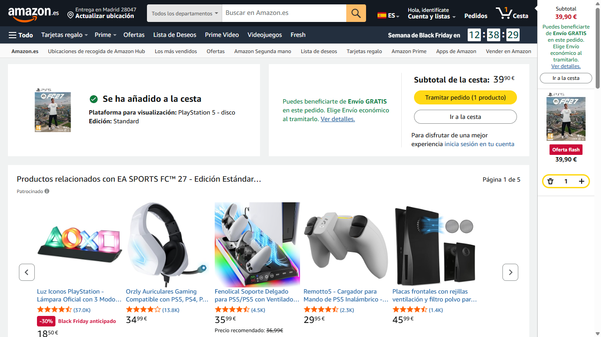

# Cypress QA – Flujo de compra en Amazon.es

Proyecto de práctica de automatización E2E con **Cypress**: busca un videojuego (EA SPORTS FC 27 para PS5), abre su ficha, lo añade a la cesta y valida el contador del carrito. Incluye una revisión de código al estilo "QA senior" hecha con ayuda de **Claude** (IA) y versionada en GitHub.

## Evidencias




## Cómo ejecutarlo
```
npm install
npm run cy:open   # modo visual
npm run cy:run    # por consola
```

## Estructura
```
cypress/
  e2e/amazon/          # test del flujo de compra
  e2e/practica/        # ejercicios de hooks del curso
  support/commands.js  # comandos reutilizables
  support/selectors/   # selectores centralizados
docs/evidencias/       # capturas del flujo
```

## Decisiones técnicas
- **Selectores en un solo fichero** (`selectors/amazon.js`): si Amazon cambia uno, se corrige en un único sitio.
- **Comandos reutilizables** (`abrirAmazon`, `buscarProducto`, `abrirResultado`, `validarContador`): el test se lee como el flujo de negocio.
- **Sin `cy.wait(n)` fijos**: todas las esperas son por condición (elemento visible, URL, texto del contador) con los reintentos de Cypress.
- **Banner de cookies condicional**: se acepta solo si aparece, sin romper el test si no sale.
- **Evidencias por paso**: `01-resultados`, `02-ficha-producto`, `03-carrito`.

## Lecciones aprendidas
- Esperar a `document.readyState === 'complete'` no funciona en Amazon, que sigue haciendo peticiones en segundo plano; se espera por elementos concretos.
- Los atributos internos de Amazon (`data-cy`, `data-component-type`) y algunos ids cambian entre sesiones: el enlace a la ficha se localiza por la URL (`/dp/`) y el título con selectores alternativos.
- El popup de protección depende del producto (aparece en portátiles). Se eligió un videojuego para tener un flujo estable.
- Amazon es un sitio de terceros con protección antibots: sirve como práctica y portfolio, no como suite fiable para CI.

## Trabajo con IA (Claude)
Claude se usó como revisor y copiloto de testing, no como piloto automático:
- **Revisión tipo QA senior** del código: selectores frágiles, esperas, comandos duplicados y estructura.
- **Iteración con errores reales**: cada fallo de Cypress (mensajes y capturas) se llevó a la conversación y cada cambio se probó ejecutando el test.
- **La IA propone, el test valida**: algunas propuestas iniciales de selectores y esperas no funcionaron en la página real y se corrigieron con el resultado de la ejecución.
- **Buenas prácticas**: cambios pequeños, revisar el diff antes de cada commit y no compartir nunca tokens ni credenciales en los prompts.

## Próximos pasos
- Añadir un segundo flujo contra un sitio de práctica estable.
- Ejecutarlo en GitHub Actions.